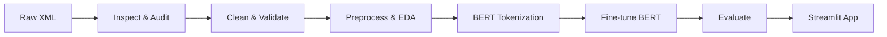
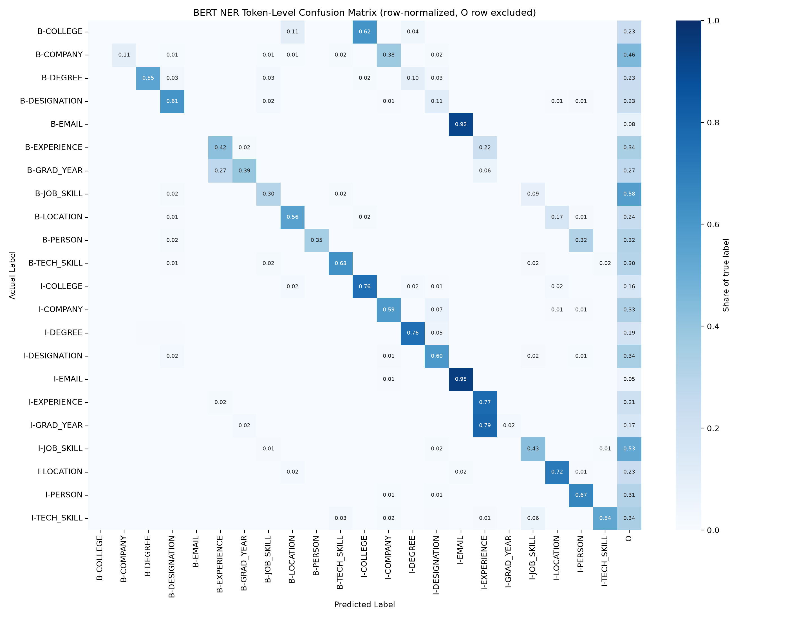
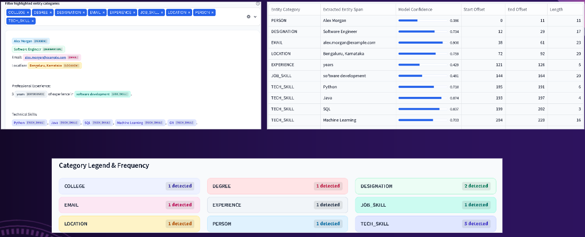

<div align="center">

# 🧠 Recruitment AI: Resume Entity Extraction with BERT

**Domain-specific Named Entity Recognition (NER) for resumes, powered by a fine-tuned Transformer**


</div>

---

## 📌 Overview

Recruiters receive hundreds of resumes in different layouts and writing styles. Reading them manually is slow and inconsistent.

This project fine-tunes **BERT (`bert-base-cased`)** for **token classification** to automatically extract structured information from raw resume text, such as names, skills, companies, degrees and more. Generic NER models only know labels like `PERSON`, `ORG` and `LOC`; this model is **domain-specific** and understands resume entities like `TECH_SKILL`, `DESIGNATION` and `GRAD_YEAR`.

## ✨ Features

- 🔎 Extracts **11 resume entity types** using 23 BIO labels
- 🧹 Full data pipeline: XML parsing, span validation, de-duplication and leakage checks
- 🤖 Fine-tuned `BertForTokenClassification` using the Hugging Face `Trainer`
- 📊 Strict entity-level evaluation with `seqeval` (IOB2) plus a confusion matrix
- 🖥️ Interactive **Streamlit** app for live resume parsing

## 🏷️ Entity Types

| Entity | Example | Entity | Example |
|---|---|---|---|
| `PERSON` | Candidate name | `JOB_SKILL` | Project management |
| `DESIGNATION` | Software Engineer | `EXPERIENCE` | 5 years |
| `LOCATION` | Delhi | `DEGREE` | B.Tech |
| `EMAIL` | name@mail.com | `COLLEGE` | University name |
| `COMPANY` | Employer name | `GRAD_YEAR` | 2024 |
| `TECH_SKILL` | Python, SQL | | |

## 🗂️ Dataset

- **Source:** [`yashpwr/resume-ner-training-data`](https://huggingface.co/datasets/yashpwr/resume-ner-training-data) on Hugging Face (XML-annotated resumes, train and test split)
- **Labels:** 11 entity types, expanded to 23 BIO tags (`B-`, `I-` and `O`)

## 🔁 Pipeline



| Step | Script | Purpose |
|---|---|---|
| 1 | `inspect_xml.py`, `inspect_dataset.py` | Explore raw XML and the HF dataset |
| 2 | `audit_xml_dataset.py` | Check labels, malformed files, duplicates, leakage |
| 3 | `clean_dataset.py` | XML → validated JSONL with character-level spans |
| 4 | `preprocess_text.py`, `eda.py` | Validate offsets, generate EDA charts |
| 5 | `prepare_bert_data.py` | Align entity spans to WordPiece tokens |
| 6 | `train_model.py` | Fine-tune BERT |
| 7 | `evaluate_model.py` | Strict seqeval metrics and confusion matrix |
| 8 | `app.py` | Streamlit demo |

### Data quality checks

- ✅ XML tags converted to character-level entity spans
- ✅ Invalid, empty or mismatched spans rejected
- ✅ SHA-256 hashing removes duplicate resumes
- ✅ Hash comparison confirms **no train/test leakage**

## 🧬 Model

| Property | Value |
|---|---|
| Base model | `bert-base-cased` |
| Architecture | `BertForTokenClassification` |
| Layers / Hidden / Heads | 12 / 768 / 12 |
| Max sequence length | 512 tokens |
| Output labels | 23 |

**Label alignment:** offset mapping assigns `B-` to the first token that overlaps an entity and `I-` to the following tokens. Special tokens are set to `-100` so they are ignored by the loss.

## ⚙️ Training Configuration

| Parameter | Value |
|---|---|
| Train / validation split | 80% / 20% (seed 42) |
| Learning rate | `3e-5` |
| Batch size | 4 |
| Epochs | 3 |
| Weight decay | 0.01 |
| Mixed precision | `fp16` on GPU |
| Model selection | Best validation F1 |

## 📈 Results

Strict entity-level evaluation (`seqeval`, IOB2) on the held-out test set:

| Metric | Score |
|---|---|
| Precision | **XX.X%** |
| Recall | **XX.X%** |
| F1-score | **XX.X%** |

<div align="center">



</div>

> The confusion matrix is token-level and row-normalized, so its numbers differ slightly from the entity-level scores above.

## 🖥️ Demo

<div align="center">



</div>

## 📁 Project Structure

```
Recruitment-NER-Transformers/
├── app.py                    # Streamlit app
├── requirements.txt
├── src/
│   ├── inspect_xml.py
│   ├── inspect_dataset.py
│   ├── audit_xml_dataset.py
│   ├── clean_dataset.py
│   ├── preprocess_text.py
│   ├── eda.py
│   ├── prepare_bert_data.py
│   ├── train_model.py
│   └── evaluate_model.py
├── data/
│   ├── raw/                  # train/ and test/ XML files (not tracked)
│   └── processed/            # cleaned JSONL files and reports
├── models/
│   └── recruitment_bert/     # fine-tuned model (not tracked)
└── screenshots/              # EDA charts, confusion matrix, demo
```

## 🚀 Getting Started

### 1. Clone and install

```bash
git clone https://github.com/<your-username>/Recruitment-NER-Transformers.git
cd Recruitment-NER-Transformers

python -m venv venv
# Windows
venv\Scripts\activate
# macOS / Linux
source venv/bin/activate

pip install -r requirements.txt
```

### 2. Get the data

Place the XML files in `data/raw/train` and `data/raw/test`.

### 3. Run the pipeline

```bash
python src/clean_dataset.py
python src/preprocess_text.py
python src/eda.py
python src/prepare_bert_data.py
python src/train_model.py
python src/evaluate_model.py
```

### 4. Launch the app

```bash
streamlit run app.py
```

> **Model weights:** the weights file is too large for GitHub. Either train your own with `train_model.py`, or download the model from [Hugging Face](https://huggingface.co/<your-username>/recruitment-bert) and place it in `models/recruitment_bert/`.

## ⚠️ Limitations

- BERT reads at most **512 tokens**, so long resumes are truncated
- Some entity types are rarer and harder to learn (class imbalance)
- Multi-word entities such as job skills and designations are the hardest to match exactly

## 🔮 Future Work

- Sliding-window inference for resumes longer than 512 tokens
- Try RoBERTa or DeBERTa, and class weighting for rare entities
- Job-description matching and candidate ranking
- PDF and DOCX resume upload in the app

## 🛠️ Tech Stack

Python · PyTorch · Hugging Face Transformers & Datasets · seqeval · scikit-learn · pandas · lxml · Matplotlib · Seaborn · Streamlit

## 👥 Authors

- **Ansh Kumar**: data pipeline, model training, evaluation, app
- **Pranav**

## 📄 License

This project is licensed under the MIT License. See `LICENSE` for details. The dataset has its own license, so check the Hugging Face page before redistributing it.

---

<div align="center">

⭐ If you found this project useful, consider giving it a star.

</div>
